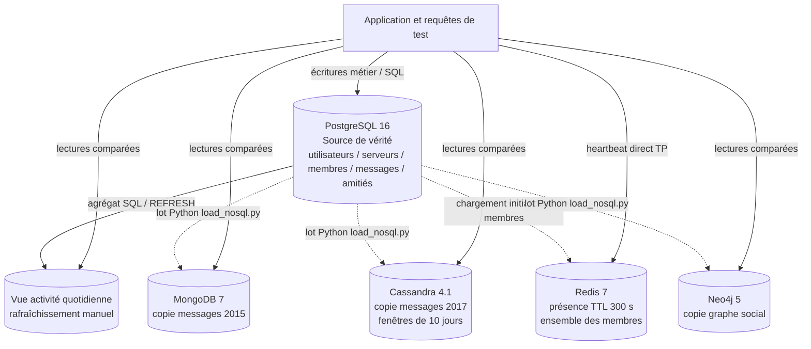

# Architecture du TP2 — implantée et cible

**Implémenté :** répliques reconstruites par le script du TP. Les écritures de présence sont testées séparément dans PostgreSQL et Redis pour comparer B2a. Le flux n'est **pas** une synchronisation de production en continu.

**Si la plateforme passait en production :** événements de changement fiables via outbox transactionnelle et consommateur idempotent, surveillance du retard des copies, règles de reconstruction après incident. Aucune double écriture non contrôlée dans l'application.

**Version minimale retenue au TP1 et maintenue provisoirement :** PostgreSQL + Redis. Cassandra, MongoDB et Neo4j sont des moteurs *candidats évalués* dans le TP2, pas un choix de production automatique.
