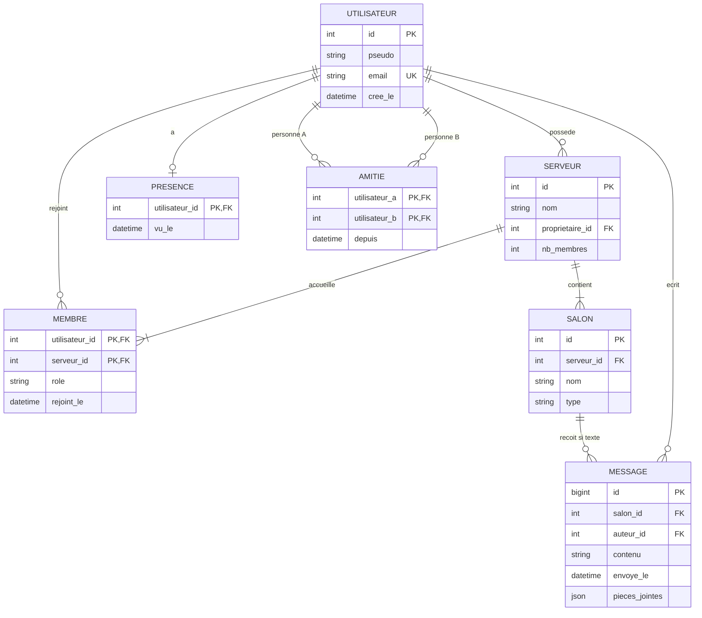

# MCD — Plateforme Discord miniature

Le MCD de départ est repris et précisé pour le TP2. Le propriétaire est aussi un membre du serveur ; cette règle supplémentaire est contrôlée en SQL par trigger différé. Les pièces jointes ont une structure variable (JSONB).

**Cardinalités importantes :** un message a un seul auteur et un seul salon ; chaque salon appartient à un serveur ; une personne peut être membre de plusieurs serveurs. Un serveur a exactement un propriétaire, présent dans `MEMBRE` avec le rôle `proprietaire`. Une amitié est symétrique et stockée une seule fois avec `utilisateur_a < utilisateur_b`.

**Règle non exprimable par simple FK :** seul un membre peut écrire dans un salon **textuel** ; vérification au moment de l'insertion du message. La présence expire en Redis au bout de 300 secondes, et doit être filtrée/purgée côté PostgreSQL.
